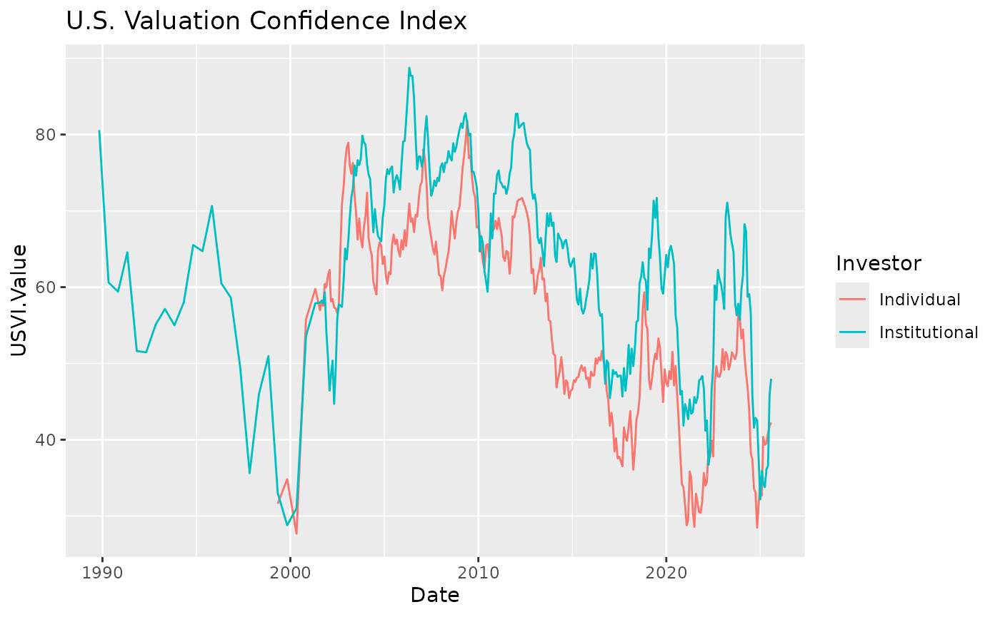

# Stock Market Confidence Indexes

## Summary

The R package `marketconf` reads data on **U. S. Stock Market Confidence
Indexes** from [Yale School of Management’s International Center for
Finance](https://som.yale.edu/faculty-research/our-centers-initiatives/international-center-finance/data/stock-market-confidence)
web page.

This package is for stock market prediction and risk valuation, and it
can be used with other packages like
[`quantmod`](https://CRAN.R-project.org/package=quantmod),
[`TTR`](https://CRAN.R-project.org/package=TTR) or
[`tidyquant`](https://CRAN.R-project.org/package=tidyquant)

## Package installation

Install the released version from CRAN:

``` r

install.packages("marketconf")
```

Or the development version from GitHub:

``` r

# install.packages("remotes")
remotes::install_github("EnriquePH/marketconf")
```

## List available indices

The four U.S. Stock market confidence indexes are derived monthly from
survey data on the investors’ behavior. These indices are:

``` r

library(marketconf)
library(knitr)
kable(US_confidence_indices())
```

| Symbol | Dir | Description | Info | Url |
|:---|:---|:---|:---|:---|
| US1YI | united-states-one-year-index | U.S. One Year Confidence Index | The percent of the population expecting an increase in the Dow in the coming year. | <https://shiller-data-public.s3.amazonaws.com/icf_stock_market_confidence_index_table.csv> |
| USVI | united-states-valuation-index | U.S. Valuation Confidence Index | The percent of the population who think that the market is not too high. | <https://shiller-data-public.s3.amazonaws.com/icf_stock_market_valuation_index_table.csv> |
| USBODI | united-states-buy-dips-confidence-index | U.S. Buy-On-Dips Confidence Index | The percent of the population expecting a rebound the next day should the market ever drop 3% in one day. | <https://shiller-data-public.s3.amazonaws.com/icf_stock_market_dips_index_table.csv> |
| USCI | us-crash-confidence-index | U.S. Crash Confidence Index | The percent of the population who attach little probability to a stock market crash in the next six months. | <https://shiller-data-public.s3.amazonaws.com/icf_stock_market_crash_index_table.csv> |

## Search for index symbol description

``` r

index_symbol <- "USBODI"
get_index_description(index_symbol)
#> [1] "U.S. Buy-On-Dips Confidence Index"
```

## Search for index symbol information

``` r

index_symbol <- "USBODI"
get_index_info(index_symbol)
#> [1] "The percent of the population expecting a rebound the next day should the market ever drop 3% in one day."
```

## Load a given index into a `data.frame`

The data is downloaded from the internet. If it is not available,
[`get_index()`](https://enriqueph.github.io/marketconf/reference/get_index.md)
shows a message and returns `NULL`, and the remaining examples in this
vignette are not evaluated.

``` r

index_df <- get_index(index_symbol)
has_data <- !is.null(index_df)
```

``` r

kable(head(index_df))
```

| Date       | USBODI.Value | USBODI.StdErr | Investor      |
|:-----------|-------------:|--------------:|:--------------|
| 1989-10-31 |        46.67 |          4.87 | Institutional |
| 1989-10-31 |        41.76 |          5.17 | Individual    |
| 1990-04-30 |        54.02 |          5.34 | Institutional |
| 1990-04-30 |           NA |            NA | Individual    |
| 1990-10-31 |        32.50 |          5.24 | Institutional |
| 1990-10-31 |           NA |            NA | Individual    |

## Plotting

This is a basic example that plots the **U.S. Valuation Confidence
Index**:

``` r

library(ggplot2)

index_symbol <- "USVI"
index_df <- get_index(index_symbol)

if (!is.null(index_df)) {
  ggplot(index_df, aes(x = Date, y = USVI.Value, color = Investor)) +
    geom_line() +
    ggtitle(get_index_description(index_symbol))
}
```



## License

The `marketconf` package is licensed under the **MIT License (MIT)**,
but the **Stock Market Confidence Indexes** are produced and copyrighted
by the **International Center of Finance at the Yale School of
Management**. Please refer to the [TERMS OF
USE](https://som.yale.edu/centers/international-center-for-finance/data/stock-market-confidence-indices/united-states)
on [Yale University](https://som.yale.edu/)’s web page for further
information.
